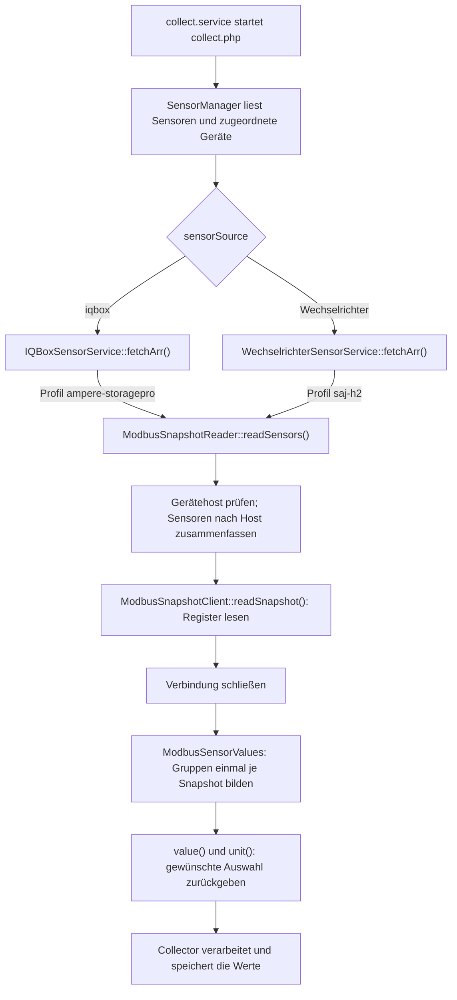
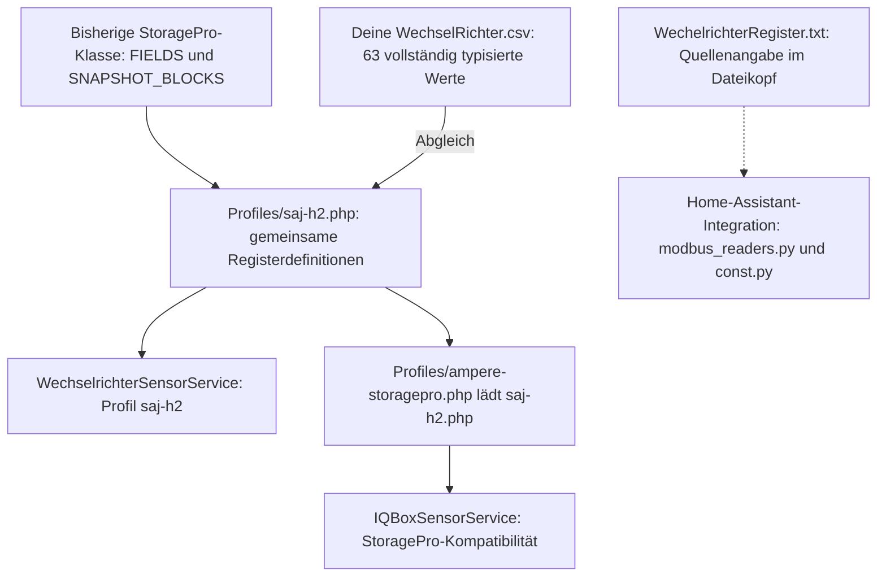

# IQBox und Wechselrichter: Lesen und gemeinsame Ansichten

Stand: 31.10.2026. Diese Beschreibung gilt für den aktuellen Code auf dem Laptop
und die Installation unter `/home/peter/scripts/coh/sensorcollect/`.

## 1. Zwei Services, ein gemeinsamer Ablauf

`IQBoxSensorService` und `WechselrichterSensorService` bleiben erhalten. Sie
entscheiden nur, für welche Gerätequelle sie zuständig sind, und geben ihr
festes Profil an den gemeinsamen Leser weiter:

| Service | Gerätequelle | Profil |
|---|---|---|
| IQBoxSensorService | `iqbox` | `ampere-storagepro` |
| WechselrichterSensorService | `wechselrichterModbus`, `wechselrichter`, `inverter`; bestehende `modbus:saj-h2[:GERAET]` | `saj-h2` |

Beide Services liefern bei gleichen Rohdaten dieselben Werte, Gruppen und
Einheiten. Die Geräteadresse bestimmt weiterhin, welches Gerät gelesen wird.
Sensor-ID, Gerätequelle und Werttyp bleiben in den Ergebnissen erhalten.



`ModbusSnapshotReader` ist eine technische Lesehilfe, kein weiterer
Sensorservice. `ModbusSensorService` und die doppelte Datei
`WechselricherSensorService.php` werden nicht mehr verwendet.

## 2. Geräteadresse und Verbindung

Die Sensoren erhalten `geraeteUrl` vom im Backend ausgewählten Gerät.
Zulässig sind IP-Adresse, einfacher Hostname sowie HTTP-/HTTPS-Adresse:

```text
192.168.178.30
wechselrichter.local
http://192.168.178.30
https://192.168.178.30/status
```

Aus einer HTTP-/HTTPS-Adresse wird nur der Host übernommen. Ein HTTP-Port,
Pfad oder Query verändert die Modbus-Verbindung nicht. Modbus verwendet fest
TCP-Port 502, Unit-ID 1 und drei Sekunden Timeout.

Die frühere Funktion `deviceConfig()` gibt es nicht mehr. Das Profil steht im
Geräte-Service fest; die Adresse wird direkt in `readSensors()` geprüft.

Ein Snapshot wird pro Gerätehost und Service-Aufruf gelesen. Alle Sensoren
für diesen Host teilen ihn. Die Verbindung wird auch bei Lesefehlern geschlossen.
IQBox und Wechselrichter haben getrennte Service-Aufrufe; für dieselbe IP
können deshalb zwei Snapshots entstehen. Es gibt keinen dauerhaften Cache.

Die optionale `clientFactory` im Konstruktor dient Offline-Tests. Die Funktion
bekommt Host und Profil und liefert einen Testclient. Im normalen Betrieb ist
sie `null` und der Leser erzeugt einen `ModbusSnapshotClient`.

## 3. Woher kommen Register und Gruppen?

`saj-h2.php` definiert die gemeinsame Grundlage:

- `fields`: Registeradresse, Datentyp, Faktor und Einheit der nativen Werte.
- `blocks` und `optional`: gemeinsame Leseblöcke und optionale Register.
- `groups`: Aufbau von `live`, `today` und `lifetime`.
- `groupDescriptions`: Hilfetexte der Gruppen für das interaktive Testprogramm.
- `aliases` und `copies`: vorhandene Alternativnamen und der historische
  Pfad `energy.house.calculatedToday` als Kopie von `energy.house.today`.

Das IQBox-Profil übernimmt dieses Array:

```php
$profile = require __DIR__ . '/saj-h2.php';
$profile['device'] = 'AMPERE.StoragePro';
return $profile;
```

Damit sind auch im IQBox-Profil `fields` und `groups` vorhanden. Die Profile
unterscheiden sich nur im Gerätenamen. Die gemeinsame Registerbelegung gilt
für die hier verwendeten StoragePro-/SAJ-HS2/H2-Geräte.

Die Gruppenbildung ist in `ModbusSensorValues::buildGroups()` ausgelagert.
Sie wird einmal je Snapshot ausgeführt. Zum Beispiel steht im Profil:

```php
'live' => [
    'batterySoc' => ['from' => 'battery.soc', 'unit' => '%'],
],
```

`from` verweist auf einen nativen Messwert. Eine Liste unter `from` nennt
Ersatzpfade in ihrer Reihenfolge. `factor => 1000` wandelt kWh in Wh um.
`transform => 'negativeAbs'` erhält die bisherige negative Darstellung der
Hausleistung in der Live-Ansicht.

Berechnete Felder verwenden `calculation` und zwei `inputs` aus bereits
aufgebauten Gruppen. `remainingPercent` berechnet den auf 0 bis 100 begrenzten
verbleibenden Anteil; `positiveDifference` die auf mindestens null begrenzte
Differenz. Im Profil stehen die Eingaben für Autarkie und Eigenverbrauch.

## 4. Dieselben lokalen IDs für beide Geräte

Lokale IDs werden bei beiden Services unabhängig von Groß-/Kleinschreibung
ausgewählt. Beispiele:

| Lokale ID | Ergebnis | Einheit |
|---|---|---|
| `soc`, `battery.soc`, `live.batterySoc` | Batterie-Ladezustand | % |
| `pv.power`, `live.pvPower`, `pvPower` | PV-Leistung | W |
| `battery`, `modbus.battery` | Native Batteriegruppe | JSON |
| `all`, `modbus` | Alle nativen Daten | JSON |
| `live`, `live.power` | Gemeinsame aktuelle Ansicht | JSON |
| `today`, `heute` | Tagesansicht | JSON |
| `today.work` | Tagesenergien mit eingebettetem `unit: Wh` | JSON |
| `today.work.generation` | Tageserzeugung | Wh |
| `today.selfSufficiency.value` | Autarkie | % |
| `today.selfConsumption.value` | Eigenverbrauchsanteil | % |
| `today.saving.energy` | Energiebilanz der Tagesansicht | JSON |
| `lifetime`, `lifetime.work` | Verfügbare Gesamtenergien und Metadaten | JSON |
| `lifetime.pvProduction`, `pv-total` | PV-Gesamterzeugung | Wh |
| `energy.pv.total`, `modbus.energy.pv.total` | Nativer absoluter PV-Zähler | kWh |

`modbus.` ist ein Auswahlvorsatz für native Daten, kein Schlüssel im JSON.
Die gemeinsame Auswahl ist `ModbusSensorValues::value()`, die zugehörige
Einheit liefert `unit()`. Eine ausdrücklich eingetragene Sensoreinheit bleibt
erhalten; eine leere Einheit oder `-` wird aus der Definition ergänzt.
JSON-Gruppen erhalten keine skalare Sensoreinheit.

Die bisherigen IQBox-Kurzformen und alten Sensor-Suffixe bleiben kompatibel.
Ebenso bleiben `soc` und `all` für den Wechselrichter erhalten. Die Rohdaten
enthalten weiterhin absolute Zähler in ihren nativen Einheiten. Die Ausgabe
von Tages-/Gesamtansichten in Wh ändert diese Rohdaten nicht.

Die `live`-Gruppe enthält genau die sechs Energieflussfelder der Cloud-Ausgabe:
`pvPower`, `housePower`, `gridPower`, `batteryPower`, `heatingRodPower` und
`batterySoc`. Zusätzliche native Bereiche werden separat über `inverter`,
`grid`, `battery`, `pv` und `house` gewählt. Alte Detailpfade wie
`live.battery.soc` bleiben kompatibel. Der Modbus-Wert für `heatingRodPower`
ist mangels Register unbekannt (`null`), auch wenn die Cloud dafür `0` meldet.

## 5. Fehlende Werte und Grenzen

Fehlende Werte einer definierten Ansicht sind `null`, keine gemessene Null.
Echte Nullmessungen bleiben als Zahl `0` erhalten; bei einer Prozentberechnung
mit einer Basis von null ist das Ergebnis unbekannt (`null`). Optionale
Netz-Summenzähler verwenden nur die im Profil genannten Ersatzwerte.

Nicht verfügbare oder unzuverlässige Netz-Gesamtwerte und der Gesamtverbrauch
bleiben in `lifetime` unbekannt. Der historische `calculatedToday`-Pfad ist
weiterhin nur eine Kopie des Hauszählers, keine neu berechnete Energiebilanz.
Kosten, Preise, Fahrzeuge und Emissionen lassen sich aus diesen Registern
nicht bereitstellen. Die bisherigen Hinweise in den JSON-Ansichten bleiben.

Ein unbekannter Sensorpfad wird protokolliert und ausgelassen. Ein Gerätefehler
verhindert nicht das Lesen anderer Geräte.

## 6. Collector, API und manuelle Abfragen

Der Collector lädt die PHP-Dateien unter `Sensor/` und registriert die
Implementierungen von `SensorFetcherInterface`. `SensorManager` ordnet die
Sensoren per `supports()` zu und übergibt sie gesammelt an `fetchArr()`.

Die Services liefern Einträge mit `sensorID`, `sensorValue`, `sensorEinheit`,
`sensorValueType` und `sensorSource`. Der vorhandene Collector verarbeitet
weiterhin die Ausgabeformen und speichert gemäß den bestehenden Regeln:
JSON-Sammelsensoren und Sensoren ohne History halten einen aktuellen Wert;
History-Sensoren speichern Änderungen und konfigurierte Kontrollpunkte.
Zähler bleiben absolut; Differenzen berechnet die History-API.

`pollTime` wird als Minuten verwendet. Der normale Collector pausiert zwischen
20:00 und 06:00 Uhr. Konsolenbetrieb und systemd-Betrieb unterscheiden sich.

| Einstieg | Zweck |
|---|---|
| `collect.php` / `collect.service` | Konfigurierte Sensoren lesen und speichern; gemeinsame Ansichten nutzen |
| `execScripts/json-inverter-modbus-loop.php` | Manuelle Abfrage derselben Werte und Gruppen wie im Collector |
| `execScripts/json-solar-iqexport-loop.php` | Derselbe manuelle Modbus-Test mit IQBox-Standardprofil |
| `var/www/html/api/coh/iqbox-modbus.php` | Bestehender HTTP-Zugriff auf den nativen Snapshot |

Der Loop verwendet ebenfalls `ModbusSensorValues`: `live`, `today`, `lifetime`
oder `get today.work.generation` liefern dieselbe Aufbereitung und Einheit wie
die Services. Standardmäßig wird nur der ausgewählte Inhalt ausgegeben, ohne
zusätzliche Metadatenhülle. `info NAME` ergänzt Host, Zeitpunkt und Einheit.
`json`/`snapshot`/`all` liefern weiterhin die native Snapshot-Hülle;
`get all` und `get modbus` liefern nur deren Datenbereich.

`help`, `groups [FILTER]` und `list [FILTER]` erzeugen ihre Auswahlhilfe aus dem
Profil, einschließlich Untergruppen, Einheiten, Registeradressen und
`groupDescriptions`. Neue Definitionen erscheinen automatisch. Diese Befehle
greifen nicht auf Geräte zu. Beispiel ohne gestarteten Loop:
`php execScripts/json-inverter-modbus-loop.php --help ampere-storagepro`.
Die Befehle sind für beide Profile identisch; Port und Unit-ID sind nur beim
manuellen Test als CLI-Argumente einstellbar.

Beide Programme verwenden `execScripts/ModbusLoop.php`. Der IQBox-Einstieg
verwendet standardmäßig `ampere-storagepro` und `iqbox>`, der Inverter-Einstieg
`saj-h2` und `inverter>`. `--once=NAME` gibt ohne interaktive Schleife genau
eine Auswahl aus. Der IQBox-Standardhost kommt aus `iqBoxModbus.host` in der
vorhandenen Task-Konfiguration; ein Host beim Aufruf hat Vorrang.
`json-solar-iqexport-loop.php` verwendet keine Cloud mehr. Die bisherigen
Cloud-Exportoptionen sind durch den lokalen Test ersetzt; Details stehen in
`execScripts/json-solar-iqexport-loop.md`.

Die bestehende HTTP-API verwendet weiterhin den nativen Snapshot ohne
Collector-Auswahl. Ihre Snapshot-Hülle bleibt erhalten. Die Klasse
`AmpereStorageProModbus` ist ihr Kompatibilitätseinstieg; die gleichnamigen
Dateien in `Sensor/`, `execScripts/` und der API sind lediglich Lade-Einstiege.

## 7. Dateien, Prüfung und Installation

Im Windows-Checkout heißt der Ordner `sensorCollect`, auf dem Raspberry
`/home/peter/scripts/coh/sensorcollect/`. Groß-/Kleinschreibung beachten.

```text
sensorCollect/Sensor/IQBoxSensorService.php
sensorCollect/Sensor/WechselrichterSensorService.php
sensorCollect/Modbus/ModbusSnapshotReader.php   Geräte lesen und Sensoren zusammenfassen
sensorCollect/Modbus/ModbusSensorValues.php     Gruppen bilden, Wert und Einheit auswählen
sensorCollect/Modbus/ModbusSnapshotClient.php   Register lesen und dekodieren
sensorCollect/Modbus/ModbusTcpClient.php        TCP-Protokoll
sensorCollect/Modbus/ModbusProfile.php          Profile laden und prüfen
sensorCollect/Modbus/Profiles/saj-h2.php        Gemeinsame Register, Gruppen und Aliase
sensorCollect/Modbus/Profiles/ampere-storagepro.php   IQBox-Gerätename
sensorCollect/Modbus/bootstrap.php             Gemeinsame Klassen laden
```

Offline-Prüfung: `php tests/modbus_snapshot_test.php`. Der Test verwendet
Fixtures sowie TCP-Testserver auf `127.0.0.1`, keine Geräte oder Datenbank.
Er vergleicht beide Services, Gruppen, Einheiten, fehlende Werte, Berechnungen,
Register/CSV-Zuordnung und Protokollfehler.

Zur Installation die betroffenen Dateien in `Sensor/` und den vollständigen
Ordner `Modbus/` vorher sichern und gemeinsam übertragen. Danach
`sudo -n systemctl restart collect.service` ausführen und den Status prüfen.
Die beiden entfernten Service-Dateien dürfen nicht in `Sensor/` liegen,
weil der Collector dort alle PHP-Dateien lädt. Der geänderte Loop gehört nach
`/home/peter/scripts/coh/execScripts/`, zusammen mit den dazugehörigen Profilen
und der gemeinsamen Aufbereitung unter `sensorcollect/Modbus/`.
Beide Loop-Einstiege benötigen außerdem die gemeinsame Datei
`execScripts/ModbusLoop.php` im selben Zielverzeichnis. Die unveränderten
API-Einstiege bleiben erhalten.

## 8. Woher stammen die Registeradressen?

### 8.1 Was wurde bei dieser Umstellung tatsächlich übernommen?

Die Registeradressen wurden bei der Verallgemeinerung **nicht neu erfunden oder
durch Ausprobieren am Gerät gesucht**. Es gab bereits zwei Grundlagen im Projekt:

1. Die bisherige Klasse `sensorCollect/Sensor/AmpereStorageProModbus.php`
   enthielt die Zuordnungen in der Konstanten `FIELDS`: Feldname, Adresse,
   Datentyp, Faktor, Einheit und Beschreibung. Dazu kamen die vorhandenen
   blockweisen Lesebereiche aus `SNAPSHOT_BLOCKS`.
2. Du hast [WechselRichter.csv](../../execScripts/WechselRichter.csv) ausdrücklich
   als Registerliste deines Wechselrichters bestätigt. Die 63 Zeilen mit
   ausgefülltem Datentyp und Faktor stimmen in Adresse, Typ, Faktor und Einheit
   mit diesen bisherigen Definitionen überein.

Ich habe die bisherigen Definitionen in das gemeinsame Profil
[Profiles/saj-h2.php](Profiles/saj-h2.php) ausgelagert und sie mit der CSV
abgeglichen. Der Test `tests/modbus_snapshot_test.php` prüft diese Übereinstimmung
auch automatisiert. Die übrigen 346 CSV-Einträge ohne ausgefüllten lokalen
Datentyp werden nicht automatisch als neue Messwerte eingebaut.

Die kleine Datei unter `Sensor/AmpereStorageProModbus.php` enthält heute nur noch
den Lade-Einstieg. Für die aktuell verwendeten Register ist deshalb jetzt
`Modbus/Profiles/saj-h2.php` die maßgebliche Code-Datei.

### 8.2 Welche ursprüngliche Quelle nennt die vorhandene Übersicht?

Im Projekt liegt zusätzlich
[WechelrichterRegister.txt](../../execScripts/WechelrichterRegister.txt)
(dies ist die tatsächliche Schreibweise des Dateinamens). Ihr Kopf nennt:

```text
Home-Assistant-Integration: custom_components/saj_h2_modbus
Quelle der Adressen:      modbus_readers.py, dort die decode maps
Abgleich der Sensoren:    const.py, dort SENSOR_TYPES
```

Das ist die **Herkunftsangabe der vorhandenen TXT-Übersicht**. Die ursprünglichen
Python-Dateien dieser Integration liegen hier nicht vor. Die Übersicht nennt
auch keine konkrete Repository-URL oder Commit-Version, mit der sich diese
Angabe vollständig bis zu einer bestimmten Integrationsfassung zurückverfolgen
ließe.

Bei dieser Umstellung habe ich keine neue externe Registerrecherche und keinen
zusätzlichen Abgleich gegen eine originale SAJ-Herstellerspezifikation
durchgeführt. Der CSV-Abgleich belegt die Übereinstimmung der vorhandenen
Projektunterlagen und des Codes; er ist keine unabhängige Herstellerbestätigung.
Insbesondere heißen die CSV-Spalten ausdrücklich `Datentyp_lokaler_Client` und
`Faktor_lokaler_Client`: Sie dokumentieren die lokale Auslegung des Clients.

| Unterlage / Datei | Welche Information stammt daraus? | Rolle heute |
|---|---|---|
| Bisherige Klasse `AmpereStorageProModbus`, damalige `FIELDS` | Vorhandene Feldnamen, Adressen, Typen, Faktoren und Einheiten | Grundlage der ausgelagerten Definitionen |
| Bisherige `SNAPSHOT_BLOCKS` | Vorhandene zusammenhängende Leseabschnitte | In das Profil übernommen |
| `execScripts/WechselRichter.csv` | Von dir bestätigte Registerliste; 63 vollständig typisierte lokale Zuordnungen | Gegen das Profil automatisch abgeglichen |
| `execScripts/WechelrichterRegister.txt` | Umfangreiche Übersicht mit Herkunftsangabe zur Home-Assistant-Integration | Zusätzliche Referenz, keine automatisch eingelesene Konfiguration |
| `Modbus/Profiles/saj-h2.php` | Tatsächlich vom gemeinsamen Leser verwendete Registerdefinitionen | Aktuelle technische Quelle zur Laufzeit |
| `Modbus/Profiles/ampere-storagepro.php` | Übernimmt Register, Gruppen und Aliase aus dem SAJ-Profil | Kompatibilitätsprofil des IQBox-Services |
| `docs/AMPERE_STORAGEPRO_MODBUS_JSON_REGISTER.md` | Bestehende Beschreibung und damalige Beispielmesswerte | Lesereferenz; alte Messwertbeispiele sind keine neue Live-Abfrage |

### 8.3 Warum verwenden IQBox und Wechselrichter dieselben Nummern?

Für diese beiden Services gibt es im aktuellen Code **keine zwei unabhängig
ermittelten Registertabellen**. Das StoragePro-Profil lädt ausdrücklich das
SAJ-Profil:

```php
// Aus Profiles/ampere-storagepro.php:
$profile = require __DIR__ . '/saj-h2.php';
```

Anschließend ergänzt es den Gerätenamen, die bisherigen Aliasnamen und den
Kompatibilitätspfad `energy.house.calculatedToday`. Die eigentlichen
Registeradressen und Umrechnungen bleiben gleich.



Der gestrichelte Pfeil steht für die Quellenangabe der TXT-Datei,
nicht für einen Dateizugriff des laufenden Collectors. Zur Laufzeit werden die
PHP-Profile geladen, nicht die CSV, die TXT-Datei oder eine Internetseite.

Der Name `IQBoxSensorService` ist hier die Bezeichnung der bestehenden
Sensorquelle. Der Service liest damit das konfigurierte StoragePro-/SAJ-Gerät
über dessen Modbus-Zugang. Es wird keine zusätzliche, eigenständige
IQBox-Registerbelegung aus der Cloud geladen. Die gemeinsame Zuordnung gilt für
die hier verwendete SAJ-HS2/H2-/StoragePro-Belegung; andere Gerätebaureihen
benötigen gegebenenfalls ein anderes Profil.

### 8.4 Beispiel: Woher kommt genau die Adresse für `Soc`?

| Stelle | Zuordnung |
|---|---|
| Deine CSV | Entität `sensor.saj_battery_1_soc`, Adresse `0xA00C` / `40972`, Typ `uint16`, Faktor `0.01`, Einheit `%` |
| Bisheriger StoragePro-Code | Feld `battery.soc` mit denselben Angaben |
| Aktuelles `Profiles/saj-h2.php` | Feld `battery.soc` mit denselben Angaben |
| Gemeinsame Auswahl | Lokale ID `Soc` wird auf `battery.soc` abgebildet |
| Beide Services | `live.batterySoc`, `battery.soc` bzw. `modbus.battery.soc` verwendet `data.battery.soc` |

Es gibt zusätzlich `battery.socSummary` an `0x406F`. Das ist ein anderes
Profilfeld. Die gemeinsame Kurzform `Soc` verwendet ausdrücklich
`battery.soc` an `0xA00C`, nicht automatisch diesen Summenwert.

`All`, `modbus`, `live.batterySoc` und andere Auswahlnamen haben keine eigenen
zusätzlichen Register. Sie bestimmen, welche bereits gelesenen Daten der Service
zurückgibt. Auch `energy.house.calculatedToday` hat kein eigenes Register: Dieser
Kompatibilitätspfad ist eine Kopie von `energy.house.today`.

## 9. Vollständige Liste der 63 Profilwerte

Die folgende Tabelle wurde aus dem aktuellen `Profiles/saj-h2.php` erzeugt und
gegen die 63 typisierten CSV-Zeilen abgeglichen. Sie gilt für das SAJ-Profil und
für die Register des darauf aufbauenden StoragePro-Profils.

- Adressen sind **nullbasierte Modbus-Protokolladressen**. Die Hex- und
  Dezimalspalten bezeichnen dieselbe Adresse. Keine zusätzliche 3xxxx-/4xxxx-
  Referenznummer davor setzen und nicht nochmals 1 abziehen.
- `uint16` und `int16` belegen ein Register. `uint32` belegt zwei Register;
  angegeben ist jeweils die Startadresse. Beispiel: `0x40BF` belegt auch `0x40C0`.
- Messwert = dekodierter Rohwert × Faktor. `int16` berücksichtigt Vorzeichen;
  `uint32` verwendet hier das höherwertige Register zuerst.
- Alle hier aufgeführten Werte werden ausschließlich mit Funktion **03** gelesen.
  Namen wie `Setpoint` bedeuten nicht, dass der Collector diese Werte schreibt.
- Für native Einzelwerte funktionieren in beiden Services der Feldpfad und
  derselbe Pfad mit `modbus.` davor, beispielsweise `pv.power` und
  `modbus.pv.power`. Auch ganze Gruppen funktionieren in beiden Services mit
  und ohne Vorsatz, beispielsweise `pv` und `modbus.pv`.
- Die beiden mit **optional** bezeichneten Netz-Summenzähler können bei nicht
  unterstützter Firmware im Snapshot fehlen.

<!-- REGISTERLISTE-START -->

### 9.1 Wechselrichter

| Feldpfad | Register hex | Register dez. | Typ | Faktor | Einheit | Bedeutung |
|---|---|---:|---|---:|---|---|
| `inverter.temperature` | `0x4010` | 16400 | `int16` | 0.1 | °C | Temperatur des Wechselrichters |
| `inverter.ambientTemperature` | `0x4011` | 16401 | `int16` | 0.1 | °C | Umgebungstemperatur des Wechselrichters |
| `inverter.dischargePowerSetpoint` | `0x4023` | 16419 | `int16` | 1 | W | Sollwert der Wechselrichter-Entladeleistung |
| `inverter.chargePowerSetpoint` | `0x4024` | 16420 | `int16` | 1 | W | Sollwert der Wechselrichter-Ladeleistung |
| `inverter.power` | `0x40A9` | 16553 | `int16` | 1 | W | Aktuelle Wechselrichterleistung |

### 9.2 Batterie

| Feldpfad | Register hex | Register dez. | Typ | Faktor | Einheit | Bedeutung |
|---|---|---:|---|---:|---|---|
| `battery.dischargeCurrentSetpoint` | `0x4025` | 16421 | `int16` | 0.1 | A | Sollwert des Batterie-Entladestroms |
| `battery.chargeCurrentSetpoint` | `0x4026` | 16422 | `int16` | 0.1 | A | Sollwert des Batterie-Ladestroms |
| `battery.statusDisplay` | `0x4027` | 16423 | `uint16` | 1 | – | Batteriestatus-Anzeige |
| `battery.protocol` | `0x4028` | 16424 | `int16` | 1 | – | Eingestelltes Batterieprotokoll |
| `battery.chargeSocUpperLimit` | `0x4029` | 16425 | `int16` | 1 | % | Obere SOC-Grenze beim Laden |
| `battery.dischargeSocLowerLimit` | `0x402A` | 16426 | `int16` | 1 | % | Untere SOC-Grenze beim Entladen |
| `battery.depthOfDischargeSetpoint` | `0x402B` | 16427 | `int16` | 1 | % | Eingestellte Entladetiefe |
| `battery.reserveSoc` | `0x402C` | 16428 | `int16` | 1 | % | Eingestellte SOC-Reserve |
| `battery.temperature` | `0x406E` | 16494 | `int16` | 0.1 | °C | Allgemeine Batterietemperatur |
| `battery.socSummary` | `0x406F` | 16495 | `uint16` | 0.01 | % | Zusammengefasster Batterie-Ladezustand |
| `battery.power` | `0x40A6` | 16550 | `int16` | 1 | W | Aktuelle Lade- oder Entladeleistung der Batterie |
| `battery.soc` | `0xA00C` | 40972 | `uint16` | 0.01 | % | Ladezustand Batterie 1 |
| `battery.soh` | `0xA00D` | 40973 | `uint16` | 0.01 | % | Gesundheitszustand Batterie 1 |
| `battery.voltage` | `0xA00E` | 40974 | `uint16` | 0.1 | V | Spannung Batterie 1 |
| `battery.current` | `0xA00F` | 40975 | `int16` | 0.01 | A | Strom Batterie 1 |
| `battery.moduleTemperature` | `0xA010` | 40976 | `int16` | 0.1 | °C | Temperatur Batterie 1 |
| `battery.cycles` | `0xA011` | 40977 | `uint16` | 1 | – | Zyklenzahl Batterie 1 |

### 9.3 Zählerbetrieb

| Feldpfad | Register hex | Register dez. | Typ | Faktor | Einheit | Bedeutung |
|---|---|---:|---|---:|---|---|
| `meter.mode` | `0x4030` | 16432 | `int16` | 1 | – | Eingestellter Zählermodus |

### 9.4 Netz

| Feldpfad | Register hex | Register dez. | Typ | Faktor | Einheit | Bedeutung |
|---|---|---:|---|---:|---|---|
| `grid.l1.voltage` | `0x4031` | 16433 | `uint16` | 0.1 | V | Netzspannung Phase L1 |
| `grid.l1.current` | `0x4032` | 16434 | `int16` | 0.01 | A | Netzstrom Phase L1 |
| `grid.l1.frequency` | `0x4033` | 16435 | `uint16` | 0.01 | Hz | Netzfrequenz Phase L1 |
| `grid.l1.power` | `0x4035` | 16437 | `int16` | 1 | W | Wirkleistung Phase L1 |
| `grid.l2.voltage` | `0x4038` | 16440 | `uint16` | 0.1 | V | Netzspannung Phase L2 |
| `grid.l2.current` | `0x4039` | 16441 | `int16` | 0.01 | A | Netzstrom Phase L2 |
| `grid.l2.frequency` | `0x403A` | 16442 | `uint16` | 0.01 | Hz | Netzfrequenz Phase L2 |
| `grid.l2.power` | `0x403C` | 16444 | `int16` | 1 | W | Wirkleistung Phase L2 |
| `grid.l3.voltage` | `0x403F` | 16447 | `uint16` | 0.1 | V | Netzspannung Phase L3 |
| `grid.l3.current` | `0x4040` | 16448 | `int16` | 0.01 | A | Netzstrom Phase L3 |
| `grid.l3.frequency` | `0x4041` | 16449 | `uint16` | 0.01 | Hz | Netzfrequenz Phase L3 |
| `grid.l3.power` | `0x4043` | 16451 | `int16` | 1 | W | Wirkleistung Phase L3 |
| `grid.powerSummary` | `0x40A7` | 16551 | `int16` | 1 | W | Aggregierte Netzleistung |
| `grid.power` | `0x40AD` | 16557 | `int16` | 1 | W | Saldierte Leistung am Netzübergabepunkt |

### 9.5 Photovoltaik

| Feldpfad | Register hex | Register dez. | Typ | Faktor | Einheit | Bedeutung |
|---|---|---:|---|---:|---|---|
| `pv.string1.voltage` | `0x4071` | 16497 | `uint16` | 0.1 | V | PV-String 1 Spannung |
| `pv.string1.current` | `0x4072` | 16498 | `uint16` | 0.01 | A | PV-String 1 Strom |
| `pv.string1.power` | `0x4073` | 16499 | `uint16` | 1 | W | PV-String 1 Leistung |
| `pv.string2.voltage` | `0x4074` | 16500 | `uint16` | 0.1 | V | PV-String 2 Spannung |
| `pv.string2.current` | `0x4075` | 16501 | `uint16` | 0.01 | A | PV-String 2 Strom |
| `pv.string2.power` | `0x4076` | 16502 | `uint16` | 1 | W | PV-String 2 Leistung |
| `pv.power` | `0x40A5` | 16549 | `int16` | 1 | W | Gesamte aktuelle PV-Leistung |

### 9.6 Hausverbrauch

| Feldpfad | Register hex | Register dez. | Typ | Faktor | Einheit | Bedeutung |
|---|---|---:|---|---:|---|---|
| `house.power` | `0x40A0` | 16544 | `int16` | 1 | W | Gesamter aktueller Hausverbrauch |

### 9.7 Energiezähler

| Feldpfad | Register hex | Register dez. | Typ | Faktor | Einheit | Bedeutung |
|---|---|---:|---|---:|---|---|
| `energy.pv.today` | `0x40BF` | 16575 | `uint32` | 0.01 | kWh | PV-Energie heute |
| `energy.pv.month` | `0x40C1` | 16577 | `uint32` | 0.01 | kWh | PV-Energie im laufenden Monat |
| `energy.pv.year` | `0x40C3` | 16579 | `uint32` | 0.01 | kWh | PV-Energie im laufenden Jahr |
| `energy.pv.total` | `0x40C5` | 16581 | `uint32` | 0.01 | kWh | PV-Energie gesamt |
| `energy.battery.chargeToday` | `0x40C7` | 16583 | `uint32` | 0.01 | kWh | Batterieladung heute |
| `energy.battery.chargeTotal` | `0x40CD` | 16589 | `uint32` | 0.01 | kWh | Batterieladung gesamt |
| `energy.battery.dischargeToday` | `0x40CF` | 16591 | `uint32` | 0.01 | kWh | Batterieentladung heute |
| `energy.battery.dischargeTotal` | `0x40D5` | 16597 | `uint32` | 0.01 | kWh | Batterieentladung gesamt |
| `energy.inverter.today` | `0x40D7` | 16599 | `uint32` | 0.01 | kWh | Wechselrichtererzeugung heute |
| `energy.inverter.total` | `0x40DD` | 16605 | `uint32` | 0.01 | kWh | Wechselrichtererzeugung gesamt |
| `energy.house.today` | `0x40DF` | 16607 | `uint32` | 0.01 | kWh | Interner SAJ-Lastzähler heute; nicht als bilanziellen Hausverbrauch verwenden |
| `energy.house.total` | `0x40E5` | 16613 | `uint32` | 0.01 | kWh | Interner SAJ-Lastzähler gesamt; nicht als bilanziellen Hausverbrauch verwenden |
| `energy.grid.sellToday` | `0x40EF` | 16623 | `uint32` | 0.01 | kWh | Netzeinspeisung (Export) heute |
| `energy.grid.sellTotal` | `0x40F5` | 16629 | `uint32` | 0.01 | kWh | Netzeinspeisung (Export) gesamt |
| `energy.grid.feedInToday` | `0x40F7` | 16631 | `uint32` | 0.01 | kWh | Netzbezug (Import) heute |
| `energy.grid.feedInTotal` | `0x40FD` | 16637 | `uint32` | 0.01 | kWh | Netzbezug (Import) gesamt |
| `energy.grid.sumFeedInToday` | `0x4167` | 16743 | `uint32` | 0.01 | kWh | Netzbezug heute, Summe **(optional)** |
| `energy.grid.sumSellToday` | `0x416F` | 16751 | `uint32` | 0.01 | kWh | Netzeinspeisung heute, Summe **(optional)** |

<!-- REGISTERLISTE-ENDE -->

## 10. Welche Register werden gemeinsam gelesen?

Ein Feld hat eine Registeradresse. Ein Leseblock hat zusätzlich eine Anzahl.
Diese Gruppierung reduziert die Zahl der einzelnen Modbus-Anfragen. Die Bereiche
stammen aus den zuvor vorhandenen `SNAPSHOT_BLOCKS` und stehen heute in `blocks`
des Profils.

| Blockstart hex | Start dezimal | Anzahl Register | Letztes Register hex |
|---|---:|---:|---|
| `0x4010` | 16400 | 2 | `0x4011` |
| `0x4023` | 16419 | 14 | `0x4030` |
| `0x4031` | 16433 | 21 | `0x4045` |
| `0x406E` | 16494 | 15 | `0x407C` |
| `0x40A0` | 16544 | 14 | `0x40AD` |
| `0x40BF` | 16575 | 32 | `0x40DE` |
| `0x40DF` | 16607 | 32 | `0x40FE` |
| `0xA00C` | 40972 | 6 | `0xA011` |

Zusätzlich werden `energy.grid.sumFeedInToday` ab `0x4167` und
`energy.grid.sumSellToday` ab `0x416F` mit je zwei Registern einzeln gelesen.
Diese beiden Abfragen sind optional.

Innerhalb der Blöcke werden auch Registerpositionen mitgelesen, denen das Profil
keinen eigenen Feldnamen zuordnet. Daraus entstehen keine zusätzlichen Werte in
`All`. Maßgeblich für die Ausgabe bleiben die 63 Felddefinitionen aus Abschnitt 9.

Für künftige zusätzliche Geräte müssen deren eigene Adresse, Datentyp, Faktor
und gegebenenfalls Wortreihenfolge im passenden Profil dokumentiert werden.
Gleiche fachliche Namen wie `battery.soc` bedeuten bei einem anderen Hersteller
nicht automatisch dieselbe Registernummer.
